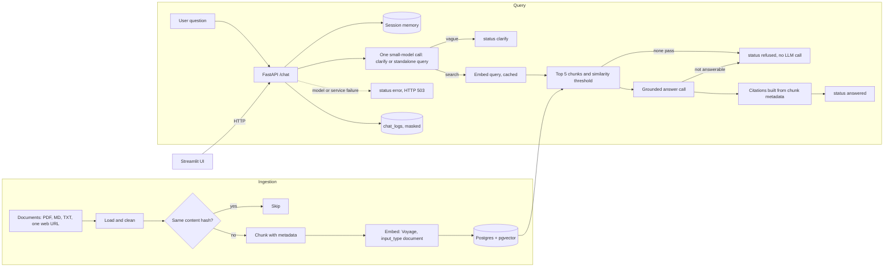

# RAG Document Chatbot (BrightSmile Dental demo)

SKELETON: headings and one-line placeholders only. Every number or claim that needs a real run says "TBD: from the real evaluation". Nothing here has been measured yet.

## What this is

A question-answering chatbot that answers only from a clinic's own documents, cites its sources, refuses what the documents do not cover and asks one short question when a request is too vague. The demo client is a fictional dental clinic, BrightSmile Dental, and all data is fictional. Portfolio project 1 of 6; its `/chat` API is reused by later projects.

## Demo scenario

TBD: filled in Milestone 7 with the exact demo questions, in order. The planned outcomes are an answer with citations, a refusal, a clarifying question, a follow-up that uses memory, and a prompt-injection attempt that is resisted.

## Architecture

Text version of the data flow as built (the PNG in `docs/architecture.png` is updated in Milestone 7):



## Quick start

TBD: verified by the clean-clone test in Milestone 7. The commands below are the ones the project documents:

```bash
cp .env.example .env            # then add your own keys; never commit .env
docker compose up -d --build    # API on http://127.0.0.1:8010, database on 5440
docker compose run --rm api python -m scripts.ingest_folder /app/data/sample_docs
```

## API

The API listens on `http://127.0.0.1:8010`. `/chat`, `/documents` and `/health` need no key (local showcase). `/ingest` and `DELETE /documents/{id}` need the `X-API-Key` header (`APP_API_KEY` in `.env`).

```bash
# Ask a question. status is answered, refused, clarify or error (HTTP 503 for error).
curl -s -X POST http://127.0.0.1:8010/chat \
  -H "Content-Type: application/json" \
  -d '{"session_id": "demo-1", "message": "Do you accept Delta Dental insurance?"}'

# Upload a file (202 Accepted; embedding continues in the background)
curl -s -X POST http://127.0.0.1:8010/ingest \
  -H "X-API-Key: $APP_API_KEY" \
  -F "files=@data/sample_docs/faq.md"

# Ingest one web page
curl -s -X POST http://127.0.0.1:8010/ingest \
  -H "X-API-Key: $APP_API_KEY" \
  -F "url=https://example.com/page.html"

# List documents with status and chunk counts
curl -s http://127.0.0.1:8010/documents

# Delete a document and its chunks
curl -s -X DELETE http://127.0.0.1:8010/documents/<document-id> \
  -H "X-API-Key: $APP_API_KEY"

# Health: API, database, pgvector and whether the keys are set (makes no paid calls)
curl -s http://127.0.0.1:8010/health
```

## The UI

TBD: start commands and screenshots after Streamlit is installed, the image is built and the page has been run. The page is a client of the API above and contains no RAG logic. It shows an answered, refused, clarify or error badge, the sources under each answer, and a documents panel.

## Configuration

All settings live in `.env` (git-ignored); `.env.example` lists every name with no values. Models, prompt versions, the similarity threshold, history length and session lifetime are settings, not code.

## How it answers

1. One small-model call turns a follow-up into a standalone query or asks one short clarifying question.
2. The query is embedded and the top 5 chunks are retrieved by cosine similarity.
3. Weak matches are dropped; if none are left the reply is a refusal and no answer model is called.
4. A grounded prompt asks the answer model to use only those excerpts and to say when they do not cover the question.
5. Citations (file, and page or section) are built in code from chunk metadata, never from model text.
6. Text from documents and users is treated as data, not instructions.

## Evaluation

TBD: from the real evaluation. The harness, rubric and a DRAFT question set are in `eval/`; no evaluation has been run and no score exists. Retrieval hit rate: TBD: from the real evaluation. Faithfulness: TBD: from the real evaluation. Answer correctness: TBD: from the real evaluation. Refusal accuracy: TBD: from the real evaluation. Latency: TBD: from the real evaluation.

## Tests

```bash
uv run pytest
uv run ruff check .
```

Tests mock Groq and Voyage and never call them. Database tests use a throwaway `ragdb_test` database on the Compose Postgres and skip if it is down.

## Known limitations

- Free-tier limits (Groq and Voyage) make throughput low; the limits are listed in `SPEC.md`.
- The similarity threshold and the answer prompt were tuned on a small calibration set; the real test is the evaluation set (TBD: from the real evaluation).
- Model outputs are not exactly repeatable at temperature 0.
- The answer model choice between `gpt-oss-20b` and `gpt-oss-120b` is provisional until the evaluation is run on both.
- Chunks are smaller than the original target size (a decision recorded in `DECISIONS.md`).
- Scanned PDFs, images and tables inside PDFs are not supported.
- `/chat` and `/documents` are open: this is a local showcase.
- Conversation memory stores masked text, so a follow-up cannot refer back to an exact email address or phone number.

## Production notes

TBD: Milestone 7.

## Data

All documents are fictional. Do not enter personal information.
