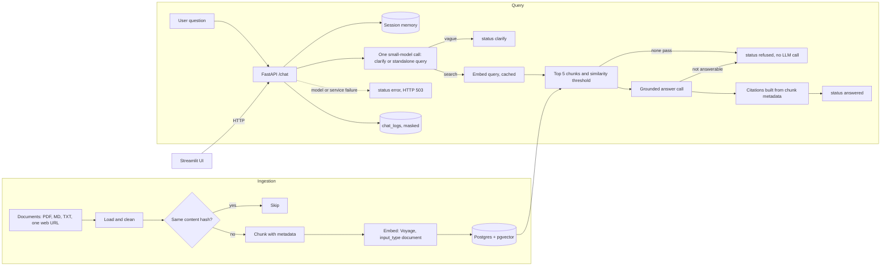

# RAG Document Chatbot (BrightSmile Dental demo)

SKELETON: headings and one-line placeholders only. Every number or claim that needs a real run says "TBD: from the real evaluation". Nothing here has been measured yet.

## What this is

A question-answering chatbot that answers only from a clinic's own documents, cites its sources, refuses what the documents do not cover and asks one short question when a request is too vague. The demo client is a fictional dental clinic, BrightSmile Dental, and all data is fictional. Portfolio project 1 of 6; its `/chat` API is reused by later projects.

## Demo scenario

TBD: filled in Milestone 7 with the exact demo questions, in order. The planned outcomes are an answer with citations, a refusal, a clarifying question, a follow-up that uses memory, and a prompt-injection attempt that is resisted.

## Architecture

Text version of the data flow as built (the PNG in `docs/architecture.png` is updated in Milestone 7):



## Quick start

TBD: the final clean-clone test is done in Milestone 7. What you need first: Docker with Compose, a free Groq API key and a free Voyage AI API key (both free tiers, no payment method), and [uv](https://docs.astral.sh/uv/) with Python 3.12 if you want to run the tests, the evaluation or the UI outside Docker. The commands below are the ones the project documents:

```bash
cp .env.example .env            # then put your two keys and a secret APP_API_KEY of your choice in .env; never commit .env
docker compose up -d --build    # API on http://127.0.0.1:8010, database on 5440
curl -s http://127.0.0.1:8010/health   # status ok once the database and both keys are set
docker compose run --rm api python -m scripts.ingest_folder /app/data/sample_docs
```

Ingesting the 30 sample documents takes a few minutes because Voyage's free plan allows only 3 requests a minute; the command prints progress, can be stopped and re-run, and skips what is already stored. Then chat with the `curl` example below, or start the UI (see "The UI").

## API

The API listens on `http://127.0.0.1:8010`. `/chat`, `/documents` and `/health` need no key (local showcase). `/ingest` and `DELETE /documents/{id}` need the `X-API-Key` header (`APP_API_KEY` in `.env`).

```bash
# Ask a question. status is answered, refused, clarify or error (HTTP 503 for error).
curl -s -X POST http://127.0.0.1:8010/chat \
  -H "Content-Type: application/json" \
  -d '{"session_id": "demo-1", "message": "Do you accept Delta Dental insurance?"}'

# Upload a file (202 Accepted; embedding continues in the background)
curl -s -X POST http://127.0.0.1:8010/ingest \
  -H "X-API-Key: $APP_API_KEY" \
  -F "files=@data/sample_docs/faq.md"

# Ingest one web page
curl -s -X POST http://127.0.0.1:8010/ingest \
  -H "X-API-Key: $APP_API_KEY" \
  -F "url=https://example.com/page.html"

# List documents with status and chunk counts
curl -s http://127.0.0.1:8010/documents

# Delete a document and its chunks
curl -s -X DELETE http://127.0.0.1:8010/documents/<document-id> \
  -H "X-API-Key: $APP_API_KEY"

# Health: API, database, pgvector and whether the keys are set (makes no paid calls)
curl -s http://127.0.0.1:8010/health
```

## The UI

Run it locally with the API running. A plain `uv sync` does not install Streamlit, so install the UI group first, then start the page from the project root:

```bash
uv sync --group ui
uv run --group ui streamlit run ui/streamlit_app.py --server.port 8510
```

The page has automated tests (Streamlit's own test runner, Streamlit 1.66.0 as locked in `uv.lock`) and was run with `streamlit run` and tested in a browser by the owner on Nov 17, 2026. TBD: screenshots. Docker, checked by the owner on Nov 17, 2026: the API image builds (`docker compose build api`, 524 MB, production dependencies only, no Streamlit by design); the UI image builds (`docker compose --profile ui build ui`) and reports Streamlit 1.66.0; `docker compose --profile ui config` parses. Not verified: the UI image has never been started as a container (the `ui` profile has not been run with `up`), and it installs Streamlit with pip, so its dependencies do not come from `uv.lock` and the image is not fully reproducible. The page is a client of the API above and contains no RAG logic. It shows an answered, refused, clarify or error badge, the sources under each answer, and a documents panel.

## Configuration

All settings live in `.env` (git-ignored); `.env.example` lists every name with no values. Models, prompt versions, the similarity threshold, history length and session lifetime are settings, not code. Current models (all Groq free plan, one OpenAI-compatible client): the small step before retrieval (clarify or rewrite) runs on `openai/gpt-oss-120b` with prompt `clarify_v2`; the answer model is `openai/gpt-oss-20b` (provisional, the final choice is made from the evaluation); the judge is `qwen/qwen3.8-27b`. Embeddings are Voyage `voyage-4` (1024 dimensions).

## How it answers

1. One model call (`gpt-oss-120b`, prompt `clarify_v2`) turns a follow-up into a standalone query or asks one short clarifying question.
2. The query is embedded and the top 5 chunks are retrieved by cosine similarity.
3. Weak matches are dropped; if none are left the reply is a refusal and no answer model is called.
4. A grounded prompt asks the answer model to use only those excerpts and to say when they do not cover the question.
5. Citations (file, and page or section) are built in code from chunk metadata, never from model text.
6. Text from documents and users is treated as data, not instructions.

## Evaluation

**How to read the results.** Two runs on the same 40 questions will be shown: the baseline (Run A) and the result after one general fix pass (runA2). The fixes were chosen after looking at Run A's failures, so the second run is not a held-out estimate of how the bot does on new questions; it shows what changed on a set that informed the changes. The numbers are in the table below once the runs are done.

TBD: from the real evaluation. The harness, rubric and the owner-approved question set are in `eval/`; no evaluation has been run and no score exists. Retrieval hit rate: TBD: from the real evaluation. Faithfulness: TBD: from the real evaluation. Answer correctness: TBD: from the real evaluation. Refusal accuracy: TBD: from the real evaluation. Latency: TBD: from the real evaluation.

## Tests

```bash
uv run pytest
uv run ruff check .
```

Tests mock Groq and Voyage and never call them. Database tests use a throwaway `ragdb_test` database on the Compose Postgres and skip if it is down.

## Known limitations

- Free-tier limits (Groq and Voyage) make throughput low: about two questions a minute, because Voyage's free plan allows 3 requests a minute and each Groq model has its own per-minute and per-day token limits (listed in `SPEC.md`). A busy period gives a friendly "try again" reply, not an answer.
- The clarify step sometimes asks a narrower question when a follow-up was already clear from the conversation (7 of 12 follow-ups handled as expected in the practice checks; those checks are not the evaluation). Clear questions and vague questions were handled correctly in those checks.
- Answers can vary between runs: model outputs are not exactly repeatable even at temperature 0, and a similar question can be answered once and refused another time when the search query wording changes.
- A vague message that names a generic subject (for example "the procedure") is searched instead of answered with a clarifying question: the bot asks only when the question has no subject, not whenever it is vague.
- The models are free-tier models and weaker than paid ones: expect more refusals of answerable questions and more variation than a paid model would give.
- The similarity threshold and the answer prompt were tuned on a small calibration set; the real test is the evaluation set (TBD: from the real evaluation).
- The answer model choice between `gpt-oss-20b` and `gpt-oss-120b` is provisional until the evaluation is run on both.
- Chunks are smaller than the original target size (a decision recorded in `DECISIONS.md`).
- An answer that spans two documents can miss the second one when the top-5 search fills slots with near-duplicate chunks from one page.
- The evaluation judge is an LLM and is somewhat strict or inconsistent about omitted side details. The scores were hand-checked on a sample of the judged answers, which checks the judge, not the chatbot.
- Scanned PDFs, images and tables inside PDFs are not supported.
- `/chat` and `/documents` are open: this is a local showcase.
- Conversation memory stores masked text, so a follow-up cannot refer back to an exact email address or phone number.

## What I would do next

- Add the document title and section heading to each chunk before embedding it.
- Add diversity to the search (MMR) so one page cannot fill several of the five slots.
- Add hybrid search: keyword plus vector.
- Add a reranker over about 15 candidates.

Any of these needs fresh held-out questions to measure; the current question set has already informed earlier changes.

## Production notes

TBD: Milestone 7.

## Data

All documents are fictional. Do not enter personal information.
