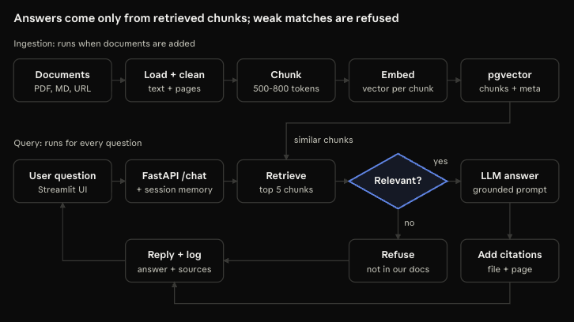

# Project 1 Spec: RAG Document Chatbot

Nov 16, 2026 · @Shoaib · Revised Nov 16, 2026 (owner decisions applied by Claude at the owner's request; see DECISIONS.md)

## Overview

We are building a production-style RAG chatbot that answers questions from a company's own documents, cites its sources, and says "I don't know" when the documents don't cover the question. It is portfolio project 1 of 6 for freelance work in conversational AI, and its retrieval API is reused later by the WhatsApp bot (project 3) and the AI front desk (project 6).

**How to use this spec with Claude:** paste it (or save it as `SPEC.md` in the repo root) at the start of a session and say: "Read SPEC.md. We are building this project milestone by milestone. Explain each design choice as you go so I understand it, and don't build anything listed as out of scope."

**Goals**

1. **Learn the system end to end:** document loading, chunking, embeddings, vector search, prompting, grounding, evaluation and serving through an API.
2. **Build a reusable service:** a clean FastAPI backend that later projects call over HTTP. The RAG logic lives in a service layer that does not depend on FastAPI routes or Streamlit.
3. **Produce a showcase for Fiverr clients:** Fiverr does not allow links, so the project is shown through a demo video and screenshots. There is no live hosting. It runs locally, and the video and screenshots must make a client trust it, so "done" means it demonstrably works and is tested well enough to show.
4. **Match real job posts:** clients ask how you design the pipeline, how you evaluate it, and how you stop the bot answering outside the knowledge base. This project must answer all three.

## Constraints

- **Total budget is $0.** Everything runs on free tiers. No Anthropic/Claude API anywhere in the project.
- API keys live only in a local, git-ignored `.env`. `.env.example` holds names only.
- Keep images lean: slim base images, no PyTorch, no local embedding models.
- Free-tier limits are tight (see Tech stack), so prompts stay compact, output length is capped, and every runner (ingest, re-embed, eval) throttles itself and can resume.
- Data is fictional. The UI shows a "do not enter personal information" note because free-plan requests may be used by providers for training.
- **Expected throughput is about 2 questions per minute** (Groq 8K tokens per minute per model, Voyage 3 requests per minute). That is fine for one person recording a demo; the demo script keeps to that pace.

## Target user and demo scenario

The client is a small service business that keeps getting the same questions by phone, email and chat. Its staff should be able to upload documents and have customers or employees ask questions in plain English.

**Demo client:** a fictional dental clinic, "BrightSmile Dental". This is the same industry the AI front desk in project 6 targets, so the knowledge base carries over.

**Demo knowledge base:** 15 to 30 documents you write or generate. Include PDFs, Markdown and one web page: services and prices, opening hours, insurance policy, cancellation policy, aftercare instructions, an FAQ and a staff handbook. Also include one document that contains an injected instruction (see requirement 6).

**Example questions the demo must handle:**

- "Do you accept Delta Dental insurance?" (answered, with a citation)
- "What's your cancellation fee if I cancel the same day?" (answered from the policy PDF)
- "What should I eat after a tooth extraction?" (answered from the aftercare document)
- "Can you recommend a good lawyer?" (refused: not in the knowledge base)
- "How much is it?" (asks a clarifying question)

## Tech stack

Everything runs locally in VS Code with Docker, using tools that appear in real RAG job posts. One option per row, kept for the whole project. Provider facts were read from the provider's own docs or console on the dates in DECISIONS.md.

| Layer | Choice | Why |
| --- | --- | --- |
| Language | Python 3.12, managed with `uv`; same version in the Dockerfile | Strongest skill; every later project reuses it |
| API | FastAPI + Uvicorn | The backend most RAG job posts ask for |
| RAG framework | LangChain text splitters only (`langchain-text-splitters`); our own loaders | Listed in many job posts; core logic stays in our own code, and the image stays lighter than with `langchain-community` |
| LLM provider | **Groq free plan only**, via one OpenAI-compatible client | Mistral and Cerebras are not free for API use. Each model has its own quota: 30 requests/min, 1K requests/day, 8K tokens/min, 200K tokens/day (owner's console) |
| Answer model | `openai/gpt-oss-120b` | Best quality available free |
| Rewrite and clarify model | `openai/gpt-oss-20b` | Small and cheap; separate quota from the answerer |
| Judge model | `qwen/qwen3.8-27b` | A different family from the answerer, so the judge is not grading its own style |
| LLM config | Provider, base URL, model, key setting, reasoning effort and output cap are separate config values for each role (answer, judge, rewrite) | Switching provider is a config change |
| Embeddings | Voyage AI `voyage-4`, 1024 dimensions, behind a small embedder interface | 200M free tokens per account; no local model needed |
| Vector database | Postgres + pgvector (Docker), HNSW index with cosine distance | One database for vectors, metadata, memory and logs; reused in projects 3 and 6 |
| Document parsing | Our own loaders on `pypdf` (PDF) and `beautifulsoup4` (HTML and web pages), plus Markdown and TXT. Scanned PDFs are out of scope | Covers the formats clients actually send |
| Chat UI | Streamlit | Fast to build |
| Evaluation | Small custom LLM-judge scorer | Numbers you can explain without notes |
| Packaging | Docker Compose, `.env`, `pytest` | What clients expect at handover |
| Hosting | None. The showcase is a video and screenshots. | See "Parked" under Open decisions |

**Free-tier handling rules**

- **Groq.** 8K tokens per minute is the binding limit. Prompts are compact and output is capped per role. gpt-oss models reason before answering, and Groq's docs say reasoning tokens are part of the output; the `reasoning_effort` setting (`low`, `medium`, `high` for gpt-oss) is set low by default. Whether reasoning tokens count toward the per-minute limit is checked against response `usage` in Milestone 3. Develop and test on the 20b to save the 120b's daily quota. A config-driven fallback moves the answerer from the 120b to the 20b when the daily cap or repeated 429s hit, and logs it. Retry with backoff on 429. Users see a friendly "service busy" message, never a stack trace. `allam-2-7b` and `gpt-oss-safeguard-20b` are not used. An optional Gemini free-tier overflow slot exists in config and is not built.
- **Voyage.** With no payment method the limits are 3 requests per minute and 10,000 tokens per minute on every model (owner's dashboard). Batches are sized by tokens (about 8K per request at most), not by text count. Requests are rate-limited to 3 per minute with backoff using `Retry-After` on 429. Ingestion is resumable and skips chunks already embedded (content hash), with progress output. Query embeddings are cached for repeated questions. The eval runner and the re-embed command obey the same limits. A local embedder is a contingency only and is not built.
- **Tests never call Groq or Voyage;** both are mocked. One live smoke test runs sparingly.

**Configuration rules.** `EMBEDDING_MODEL` and `EMBEDDING_DIMENSIONS` are config values. The pgvector column size comes from config through the migration, never hard-coded in several places. The embedding model name is stored with every chunk. On startup the app warns or fails clearly if config and the database disagree. A re-embed command rebuilds all vectors from the stored chunk text. `DATABASE_URL` is a single setting.

## Architecture and data flow

The system has two pipelines that share one pgvector database: ingestion prepares the documents once, and the query pipeline runs for every question. The target diagram is below. It is a simplified version; this section is the full flow.



**Ingestion:** load and clean (text plus pages) → **content-hash check** (skip unchanged files, update changed ones) → chunk (target up to about 600 tokens, split at headings, tiny sections merged; short documents give smaller chunks; with overlap) → embed (Voyage, `input_type=document`, batches of about 8K tokens, 3 requests per minute, resumable) → store in pgvector with metadata and the embedding model name.

**Query (clarify before retrieving):**

1. User question (Streamlit or API) → FastAPI `/chat` plus session memory.
2. **One small-model call** (`gpt-oss-20b`) sees the chat history and the question and returns either a clarifying question or a standalone search query. The history rewrite and the clarify check are merged into this one call. If it returns a clarifying question, the reply is `status=clarify` and nothing else runs.
3. Embed the standalone query (Voyage, `input_type=query`, cached) → retrieve the top 5 chunks → apply the similarity threshold.
4. **No chunk passes the threshold:** reply `status=refused` with the fixed message. No answer-model call is made.
5. Otherwise one grounded call to the answer model (`gpt-oss-120b`) returns a structured result. If it says the chunks do not contain the answer, the reply is `status=refused`.
6. Build the reply and citations in code from chunk metadata, then log.

**Three outcomes (`status`):** `answered`, `refused`, `clarify`. A model or service failure returns `status=error` with HTTP 503 and a friendly "service busy, try again" message (the text is configurable), is logged as an error, and never shows a stack trace. (Added in Milestone 3, owner decision; see DECISIONS.md.)

**Citations are built in code from the metadata (file, page) of the chunks actually retrieved and used, never from text the LLM writes.** Every exchange is logged so evaluation can trace which chunks produced each answer.

**Service layer.** The pipeline above lives in `app/services/` as plain functions and classes with no FastAPI or Streamlit imports. The routes and the UI call it. Projects 3 and 6 reuse the `/chat` API.

**Differences between the owner's diagram and this spec (diagram to be updated):** the diagram has no dedup step, no history rewrite and clarify call, no `clarify` outcome and no query `input_type`. Its "URL" source is in scope (requirement 1), so it stays.

## Functional requirements

The chatbot must do these 10 things; each one maps to a question clients ask in job posts.

1. **Ingest documents:** load PDF, Markdown, TXT and one web URL from a folder (CLI script, safe to re-run) or an upload endpoint. URL loading is one page the owner names, not a crawler.
2. **Clean and chunk:** split text into chunks (target up to about 600 tokens, split at headings, tiny sections merged; short documents give smaller chunks), with overlap. Keep metadata on every chunk: file name, page, section heading. **"Page" means the PDF page number (1-based). For Markdown, TXT and HTML it is null, and the nearest section heading is stored in `section` and shown in citations instead.**
3. **Embed and store:** embed each chunk (`input_type=document`) and store it in pgvector. A content hash of each file is checked between load and chunk; re-ingesting the same file updates it instead of creating duplicates. Ingestion is resumable and throttled (see free-tier rules).
4. **Retrieve:** embed the standalone query (`input_type=query`); return the top 5 chunks by vector similarity. A score threshold drops weak matches.
5. **Answer with citations:** the LLM answers only from the retrieved chunks, and each answer lists its sources as file name plus page (or section), built from chunk metadata.
6. **Refuse out-of-scope questions:** when no chunk passes the threshold, or the chunks don't contain the answer, reply with a fixed message such as "I couldn't find that in our documents. Please contact the clinic." (`status=refused`). A weak match is refused without calling the answer model. **Text inside documents and user messages is data, never instructions: the knowledge base includes a document containing "ignore previous instructions", and a test proves it does not change the bot's behaviour.**
7. **Ask for clarification:** before retrieval, one small-model call decides whether the question is too vague to answer and, if so, returns one short follow-up question (`status=clarify`). Its latency, token cost and accuracy on the vague eval questions are measured in Milestone 5.
8. **Keep short conversation memory:** a Postgres table keyed by session ID; the last N turns go into the rewrite and clarify call; old sessions expire. This is what makes follow-ups like "and on Saturdays?" work.
9. **Log every exchange:** save the question, standalone query, retrieved chunk ids, status, answer, latency and token use to Postgres. Emails and phone numbers are masked in logs.
10. **Expose an API:** all features go through FastAPI so projects 3 and 6 can call `/chat` over HTTP. Rate limits (429) and other LLM failures are retried with backoff, then reported as a friendly message.

## In scope / out of scope

If a feature isn't in the in-scope list, don't build it in this project. Most out-of-scope items are covered by projects 2 to 6.

**In scope**

- Ingestion pipeline for PDF, Markdown, TXT and one web URL, with content-hash de-duplication, throttled and resumable
- Chunking with metadata, embeddings and storage in pgvector; re-embed command; optional, local-only pre-embedded seed file for the sample documents (decided in Milestone 2: built but never committed)
- Clarify-before-retrieval call, vector retrieval with a similarity threshold
- Grounded answers with citations (file and page) built from metadata
- Refusal for out-of-scope questions and clarifying questions for vague ones, with a `status` field
- Short conversation memory per session (Postgres)
- FastAPI endpoints: `/ingest`, `/chat`, `/documents`, `DELETE /documents/{id}`, `/health`; `X-API-Key` on `/ingest` and DELETE
- Streamlit chat UI that shows sources clearly and makes the three outcomes look different
- Logging of questions, answers, sources, latency and token use, with PII masking
- LLM retry/backoff, model fallback and friendly error replies
- An evaluation set of 30 to 50 questions, with a throttled, resumable evaluation script and a results table
- The test suite in "Testing standard" below, including a prompt-injection test
- Docker Compose setup, `.env` configuration
- The Showcase deliverables in Milestone 7

**Out of scope (later projects or future upgrades)**

- WhatsApp, phone, voice or SMS channels (projects 3 to 6)
- n8n workflows, CRM, calendar or Slack integrations (project 2 onwards)
- Agents and tool calling; the bot only answers questions (project 6)
- User accounts, login, multi-tenant support for several clients
- An admin dashboard beyond a simple document list
- Fine-tuning or training models
- Hybrid search, re-ranking (optional upgrades after the evaluation baseline)
- Prompt Guard models as an injection check (possible later; not built now)
- Images, tables inside PDFs, scanned documents and OCR (note in README)
- Live hosting or any deployment
- Production cloud hosting, autoscaling, monitoring stacks
- A custom embeddable website widget (the capstone covers web chat)
- Languages other than English

## API endpoints

| Method | Path | Auth | Purpose |
| --- | --- | --- | --- |
| POST | `/ingest` | `X-API-Key` | Upload files or a URL; parse, chunk, embed and store them |
| GET | `/documents` | none | List ingested documents with chunk counts |
| DELETE | `/documents/{id}` | `X-API-Key` | Remove a document and its chunks |
| POST | `/chat` | none | Body: `session_id`, `message`. Returns `answer`, `status` (`answered` / `refused` / `clarify`, or `error` with HTTP 503 when a model or service fails), `sources[]`, `latency_ms` |
| GET | `/health` | none | Checks the API, database (and pgvector) and whether the LLM and embedding keys are set. It makes no paid or rate-limited calls. |

`/chat` and `/documents` are open because this runs locally for a showcase. The `APP_API_KEY` value comes from `.env`. The README's Production notes say a real deployment needs authentication on every route.

## Project structure

```text
rag-chatbot/
  app/
    main.py            # FastAPI app and routes (thin)
    config.py          # settings from .env, per-role LLM config
    health.py          # health report
    services/          # the RAG pipeline: no FastAPI or Streamlit imports
    ingest/            # loaders, chunker, embedder interface + Voyage implementation
    retrieval/         # vector search + threshold
    generation/        # LLM wrapper (OpenAI-compatible), citations, refusal
    memory.py          # per-session chat history (Postgres)
    db.py              # Postgres + pgvector models, migrations
  prompts/             # versioned prompt files (e.g. answer_v1.txt, rewrite_v1.txt)
  scripts/             # check_keys, ingest_folder, reembed
  ui/streamlit_app.py  # demo chat UI
  eval/
    questions.jsonl    # 30-50 questions with expected answers and sources
    run_eval.py        # throttled, resumable; writes results.md
    README.md          # judge rubric and how to run
  data/sample_docs/    # BrightSmile Dental knowledge base
  db/init/             # SQL run when the database is first created
  docs/                # architecture diagram, case study, demo script, screenshot list
  tests/
  Dockerfile
  docker-compose.yml
  .env.example
  README.md
  SPEC.md              # this document
  WORKFLOW.md  CLAUDE.md  DECISIONS.md  NOTES.md
```

## Testing standard

"Good enough to show a client." All of this must pass before Milestone 7:

- **Unit tests:** chunking, dedup, citation building from metadata, log masking, the API-key check, the `/chat` status contract (`answered`, `refused`, `clarify`).
- **Integration tests with Groq and Voyage mocked:** ingest, then chat, then citations, refusal, clarification and memory.
- **Failure-mode tests:** Groq 429 and timeouts, Voyage 429, empty database, no relevant chunk, malformed upload, duplicate upload.
- **Prompt-injection test:** a document containing "ignore previous instructions" must not change behaviour.
- **A live smoke test** with the real keys, run sparingly because of quotas.
- **The evaluation run** against the targets below, with the full report saved.

## Evaluation

The evaluation set answers the client question "how do you know it works?" with numbers. Write 30 to 50 questions: about 70% answerable, 20% out of scope, 10% vague. The owner writes or approves every question and expected answer. The answerable questions include terse ones (for example "opening hours?") to check that the clarify step leans toward answering.

| Metric | What it checks | Target |
| --- | --- | --- |
| Retrieval hit rate | The correct source is in the top 5 chunks | 90% or higher |
| Faithfulness | The answer only uses facts from the retrieved chunks | 90% or higher |
| Answer correctness | The answer matches the expected answer | 85% or higher |
| Refusal accuracy | Out-of-scope questions are refused, answerable ones are not | 95% or higher |
| Status accuracy | Vague questions get `clarify`, others do not | reported; target set after baseline |
| Latency | Time from question to full answer | Under 3 seconds (p50). Measured in Milestone 5 and reported honestly; not relaxed before then |

The judge is a custom LLM-judge scorer (one or two calls per question) on `qwen/qwen3.8-27b`, a different family from the answerer. The owner hand-checks about 10 verdicts. The rubric is documented in `eval/README.md`. The runner throttles itself to stay inside free-tier limits and can resume across days. **Owner's estimate: one full pass needs roughly a day of 120b answer quota and one to two days of judge quota.** Where a score is close to its target, run it more than once and report the spread. In Milestone 5, measure the clarify-before-retrieving call's latency, token cost and accuracy on the vague questions and record the result in DECISIONS.md.

Run the evaluation after every major change and keep a results table in the README showing before and after.

## Milestones

1. **Setup:** repo, Docker Compose with Postgres and pgvector, FastAPI `/health`, `.env` config, `uv` and Dockerfile on Python 3.12, a key-check script. Leaves a clean hook for the clarify-before-retrieval step.
2. **Ingestion:** loaders, content-hash dedup, chunking with metadata, embedder interface (Voyage, token-sized batches, 3 requests per minute, resumable, query-embedding cache), storage, re-embed command, config/DB model-mismatch check, `/ingest` (with `X-API-Key`), `/documents`, DELETE, folder-ingest script, and a decision on a pre-embedded seed file.
3. **Retrieval and answers:** the LLM client with retry, backoff and the 120b to 20b fallback, vector search with threshold, grounded prompt, metadata-built citations, `/chat`, a clean hook for the clarify step.
4. **Guardrails and memory:** the clarify-before-retrieving call (`gpt-oss-20b`, merged with the history rewrite), refusal without an LLM call on weak matches, `clarify` status, session memory, logging with masking.
5. **Evaluation:** **at the start, before any evaluation run, Claude reminds the owner to run the evaluation on both `openai/gpt-oss-20b` and `openai/gpt-oss-120b` (set `ANSWER_LLM_MODEL` in `.env` for each run) and to choose the final answer model from the numbers. `gpt-oss-20b` and prompt `answer_v2` are the provisional defaults from Milestone 3 (DECISIONS.md D-036). Evaluation numbers and the demo video must use the final chosen model. The evaluation script prints the active answer model and prompt version at startup and records them in the results file.** Then: write the question set, build `run_eval.py`, record baseline scores, measure the clarify call's latency, token cost and accuracy, tune chunk size and threshold, prompt-injection test, latency (p50).
6. **UI and packaging:** a working Streamlit UI that shows answers and their sources (polished in Milestone 7), the complete test suite from the Testing standard (the eval run closes Milestone 7), README skeleton, architecture diagram check.
7. **Showcase:**
   - A polished Streamlit UI that shows sources clearly and makes the answered, refused and clarify outcomes visibly different, with loading and friendly error states and the "do not enter personal information" note.
   - A demo script using the demo scenario, with exact questions in order, timed to stay under about 2 questions per minute, and a pre-demo checklist.
   - A list of screenshots to capture: an answer with citations; a refusal; a clarification; a follow-up using memory; the document list with ingest and delete; the eval report table; the architecture diagram; a prompt-injection attempt being resisted.
   - A README with setup steps (`docker compose up`, then seed or ingest, then chat), plus curl examples for the API.
   - A one-page client-facing case study with the real eval numbers.
   - A "Production notes" section: this runs on free tiers for a portfolio; for a real client, the LLM and embedding providers are swapped by config (paid models, data isolation), plus authentication, a managed database and monitoring. It claims nothing that was not tested.
   - The final eval report.

At the end of every milestone, Claude stops, reports what was built, verified and not verified, and summarises it for the owner's review. When asked, Claude drafts a summary; the owner approves it before it is saved to `NOTES.md`.

## Open decisions

None blocking. Closed or parked:

- **Hosting: not needed.** The showcase is a video and screenshots; live hosting is parked. Parked options: Streamlit Community Cloud with a hosted Postgres; Streamlit plus FastAPI on Render free; Hugging Face PRO is excluded by the $0 rule. (Hugging Face Docker Spaces need a paid plan; Spaces also limit outbound ports.) `DATABASE_URL` stays a single setting so hosting could be revisited.
- **Clarify strategy: decided.** Clarify before retrieving, in Milestone 4, measured in Milestone 5.
- **Answer provider: decided.** Groq only.

## Definition of done

- [ ] All 10 functional requirements work through the API and the UI
- [ ] Evaluation scores meet the targets above (or are reported honestly if not), with results in the README
- [ ] Everything in the Testing standard passes, including the prompt-injection test
- [ ] README has an architecture diagram, setup steps, curl examples, evaluation results, known limitations and Production notes
- [ ] Demo script, screenshot list and a client-facing case study exist; the owner can record the video from them
- [ ] You can explain every component, and why you chose it, without notes
