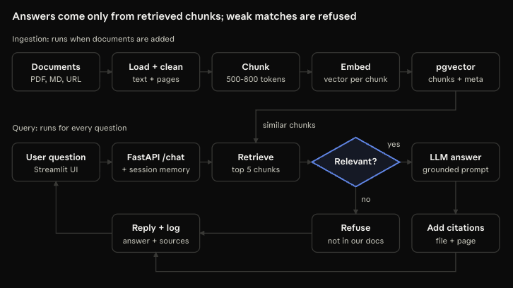

# Case study: a document chatbot that says "I don't know"

**Project:** a question-answering chatbot for a fictional dental clinic (BrightSmile Dental). It answers only from the clinic's own documents, shows the file and page it used, refuses what the documents do not cover, and asks one short question when a request is too vague. I built it on free tiers on purpose, to show the design works and to measure it at no cost; a real deployment would use paid models. Everything runs locally in Docker; all data is made up.

## The problem

A small service business answers the same questions all day by phone, email and chat: what insurance is accepted, what to do after an extraction, how to cancel. The documents that hold the answers exist, but nobody wants to search them. A chatbot can help, but only if staff can trust it. A bot that guesses is worse than no bot, so three behaviours mattered more than fluent answers:

1. Every answer comes with a source the reader can check.
2. When the documents do not cover a question, the bot says so instead of inventing something.
3. When a question is too vague to answer ("How much is it?"), the bot asks what is meant.

## Constraints of this build

- **Budget: $0, by choice.** Free tiers only: Groq for the language models and Voyage for embeddings, no paid API. A client deployment would use paid models and embeddings instead. Models, prompts and thresholds are settings, so changing the provider or model is a configuration change; a different embedding model means re-embedding the documents, which a script does.
- **Free limits shape this demo, not the design.** Voyage allows 3 requests a minute and each Groq model has its own per-minute and per-day token limits, so the demo handles about two questions a minute. A busy period gives a friendly "try again" reply, not a wrong answer.
- **Shown as a video and screenshots.** It runs on my machine, not on a public link.

## How it works

- **Ingestion.** PDF, Markdown, text and one web page are cleaned and split into chunks that keep their file, page and section. Chunks are embedded with Voyage and stored in Postgres with pgvector. A file that has not changed is skipped (content hash), so re-running is safe. The sample set is 29 documents, 89 chunks.
- **Answering.** One small model call turns a follow-up into a standalone search query or decides to ask one clarifying question. The query is embedded and the 5 closest chunks are fetched. Weak matches are dropped by a similarity threshold, and a grounded prompt answers from what is left.
- **Citations are built in code**, from the stored chunk metadata, never from the model's text. A model cannot cite a page it made up.
- **Everything is logged** with emails and phone numbers masked, and conversation memory is forgotten after a day.
- **A FastAPI service with a Streamlit page.** The chat is an HTTP API, so later projects can reuse it.

## How I measured it

Calling a chatbot "accurate" means nothing without numbers, so I wrote 40 fixed questions with expected answers taken from the documents: 29 answerable, 7 out of scope and 4 vague. Code scores what it can check exactly (was the right source retrieved, did the bot answer, refuse or ask as expected, how long did it take). A separate judge model, from a different family than the answering model, scores whether an answer is correct and whether it stuck to the retrieved text.

I kept the judge honest. I hand-checked its verdicts and found it strict about omitted side details and a little inconsistent, so I read every one of its zero scores myself and counted an answer as correct if I rated it 7 out of 10 or better. I also fixed a defect in how judge calls were retried, because verdicts that never arrived would have made the runs impossible to compare. Hand review checks the judge, not the chatbot, and it can only raise the scores.

## What happened

**The baseline (Run A)** missed most targets. Retrieval found every expected source for 69% of answerable questions, correctness was 39%, and refusal accuracy was 69%. Looking at the failures, three causes stood out: seven clear questions had been turned into clarifying questions, several correct questions scored just under my similarity threshold of 0.40 and were refused, and the answering model never saw the user's original wording, only a rewritten search query.

**One fix pass**, chosen after seeing those failures (and so not an independent test):

- Lower the similarity threshold from 0.40 to 0.33, set a little above the highest score of any truly unrelated question in a separate practice set, then check on practice data that out-of-scope near misses were still refused.
- With no conversation history, search with the user's own words instead of a rewrite, and give the answering model the original question. A practice check showed this kept the expected source in the top 5 for all 16 practice questions.
- Add a guard: if the model asks a clarifying question about something the message already names, search instead.

I did not tune anything else on the 40 questions.

**The result**, one run per setup (the final answer model is `gpt-oss-20b`; `gpt-oss-120b` scored the same within noise):

| Metric | Target | Baseline | After the fix pass (20b) | 120b |
| --- | --- | --- | --- | --- |
| Retrieval hit rate (all sources) | 90% | 69.0% | 79.3% | 82.8% |
| Faithfulness (judge) | 90% | 100% | 100% | 100% |
| Correctness, judge | 85% | 39.3% | 69.0% | 71.4% |
| Correctness, hand-reviewed | 85% | not recomputed | 72.4% | 75.9% |
| Refusal accuracy | 95% | 69.4% | 80.6% | 83.3% |
| Latency, median | under 3 s | 1.6 s | 2.1 s | 2.2 s |

The two targets that were met are faithfulness, where every answer the judge checked stuck to its sources, and latency. Retrieval, correctness and refusals are better than the baseline but **not at target**.

## What I would not claim

- **These are not held-out results.** The fixes were chosen after seeing the baseline on the same 40 questions, so the improvement is optimistic. A fresh set of questions is the honest next measurement.
- **One run is noisy**, about one or two questions either way, and the clarify step is not deterministic. The 20b and 120b models are one question apart on every measure, so I claim no difference between them. I chose 20b for speed and to spread the free quota across two models, not for accuracy.
- **The guard has a cost.** Vague questions that name a generic subject ("the procedure") are now searched instead of answered with a clarifying question: correct handling of the 4 vague questions went from 100% to 50%. I accepted that on purpose, because the guard rescued several clear questions that the baseline had wrongly turned into clarifying questions.
- **The threshold margin is thin.** The 0.33 gate was chosen by hand from a small practice set. Out-of-scope questions that sound dental overlap with real questions in similarity score, so no threshold can separate them; the answering prompt has to.
- **These numbers describe free models.** A paid model would probably refuse fewer answerable questions and vary less between runs, but I have not measured that, so I claim no number for it. The evaluation can be re-run on any model, so a client's chosen model can be measured the same way before launch.
- **Some failures are the free models, not the design,** and some are the design. The two retrieval misses and the answers that span two documents are retrieval problems I could fix. A free model sometimes refuses a question that the retrieved text answers, and it can answer in one run and refuse in the next. I labelled each failure instead of blaming the model by default.

## What I would do next

- Add the document title and section heading to each chunk before embedding it, add diversity to the search so one page cannot fill several of the five slots, and test hybrid (keyword plus vector) search and a reranker.
- Measure every change on fresh held-out questions, not on the 40 that informed the first fixes.
- For a real client, first re-run the evaluation on the paid models they choose, then add data isolation, authentication on every route, upload limits, a managed database, backups and monitoring. The production notes in the repository list these.

## Links

Repository: github.com/shoaibhassancs/rag-document-chatbot (README with the full results table and limitations; `eval/results/` holds the per-run summaries and the hand-review verdicts).
